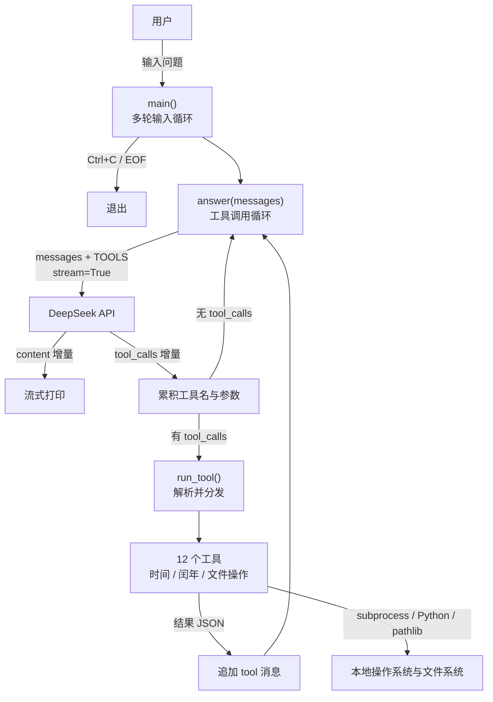

# Project2

基于 Project1 的 DeepSeek 命令行聊天程序，支持流式输出、多轮对话和本地 function call 工具。

## 文件结构

| 文件 | 说明 |
| --- | --- |
| `chat.py` | 基础版：`getDate` 时间工具 |
| `chat_year.py` | 在 `chat.py` 基础上新增 `isleapyear` 闰年工具 |
| `chat_file.py` | 在 `chat_year.py` 基础上新增 10 个本地文件操作工具 |
| `chat_file_architecture.mmd` | `chat_file.py` 的 Mermaid 架构图（纯文本） |
| `requirements.txt` | Python 依赖 |
| `.env` / `config.ini` | API Key 配置（本地使用，不提交仓库） |
| `config.ini.example` | 配置模板 |

## 功能

所有程序均支持：

- 多轮对话，保留上下文
- 流式逐字输出模型回复
- 按 `Ctrl+C` 退出，空输入自动跳过
- 模型自主发起 function call，程序执行工具后继续生成回答

### chat.py

| 工具 | 说明 | 实现方式 |
| --- | --- | --- |
| `getDate` | 获取当前电脑日期和时间 | 调用本地 `date` 命令：Windows 为 `date /t & time /t`，Linux/macOS 为 `date` |

### chat_year.py

| 工具 | 说明 | 实现方式 |
| --- | --- | --- |
| `getDate` | 获取当前电脑日期和时间 | 同 `chat.py` |
| `isleapyear` | 判断指定年份是否为闰年 | Python 计算：能被 4 整除且不能被 100 整除，或能被 400 整除 |

### chat_file.py

除 `getDate`、`isleapyear` 外，还提供以下文件操作工具：

| 工具 | 说明 |
| --- | --- |
| `get_cwd` | 获取当前工作目录绝对路径 |
| `list_directory` | 列出指定目录下所有文件和子目录（含类型、大小） |
| `get_file_type` | 获取文件类型：MIME、扩展名、文本/二进制、大小 |
| `read_text_file` | 读取纯文本文件内容，自动识别编码 |
| `create_file` | 按目录和文件名创建文件，目录不存在时自动创建 |
| `edit_file` | 覆盖（`overwrite`）或追加（`append`）纯文本内容 |
| `create_directory` | 创建目录，自动创建父目录 |
| `delete_directory` | 递归删除非空目录 |
| `delete_file` | 删除文件 |
| `rename_path` | 重命名或移动文件/目录 |

实现细节：

- 相对路径基于当前工作目录解析，支持 `~` 展开
- 读取/编辑纯文本时按 UTF-8 → 系统编码 → GBK 顺序尝试解码，并拒绝二进制文件
- 单文件读写上限 2 MB
- 删除目录时禁止删除磁盘根目录、用户主目录、当前工作目录及其父目录
- 错误统一以 JSON `{"error": ...}` 返回给模型

## 架构图

`chat_file.py` 的完整架构图见 [`chat_file_architecture.mmd`](./chat_file_architecture.mmd)。



## 使用

1. 安装依赖：

```bash
py -m pip install -r requirements.txt
```

2. 配置 API Key（二选一）：

- 在 `.env` 中设置：

```env
DEEPSEEK_API_KEY=sk-your-deepseek-key-here
```

- 或复制 `config.ini.example` 为 `config.ini` 并填写 `api_key`。

3. 运行：

```bash
py chat.py        # 时间工具
py chat_year.py   # 时间 + 闰年工具
py chat_file.py   # 时间 + 闰年 + 文件操作工具
```

示例提问：

- `今天是星期几？现在几点？`
- `2024 年是闰年吗？`
- `列出当前目录下的所有文件，然后创建一个 test 目录。`
- `读取 notes/todo.txt 的内容，并追加一行 "done"。`

> 注意：API Key 只保存在本地 `.env` / `config.ini`，不要提交到仓库。
